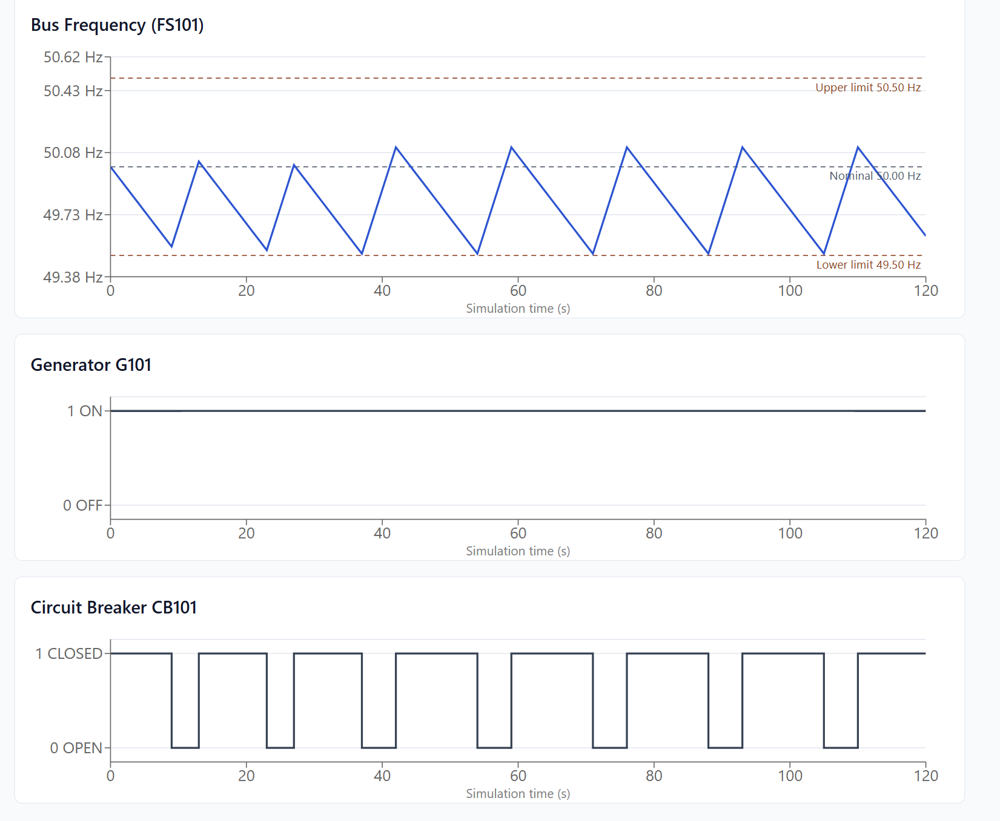
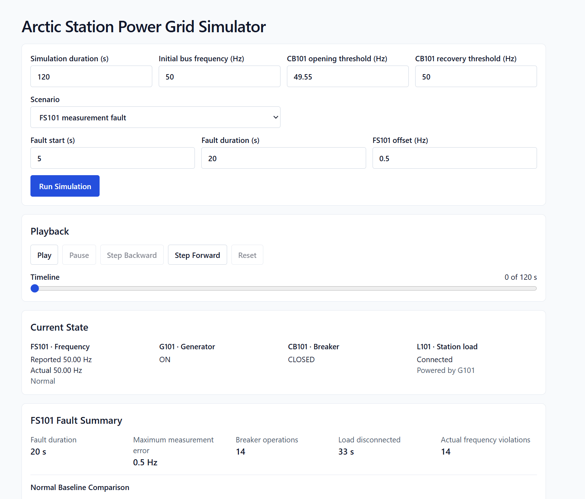

# AI Usage

In coming up with the simulator for this assignment, I made use of both ChatGPT and Codex.

I used **ChatGPT** to work through the task brief, preparing detailed and comprehensive prompts that i could feed **Codex** with for code generation and iteration.

I started by asking for a basic working simulation loop rather than a complete polished application. I wanted the physics, controller, and UI kept separate, configurable parameters, reusable functions, and logging and sanity checks that would make the model easier to test.

I tested each iteration by running different simulation scenarios, examining the frequency and component-state graphs, checking metrics and event logs against the specified physical rules, and investigating unexpected behaviour and my findings that arised from these tests guided the next iterations.

## How the project developed

| Stage | What I focused on |
| --- | --- |
| Initial simulator | Implement the supplied frequency rates and automatic breaker control, then check the three required graphs. |
| Review of the first run | A 120-second run showed 87 seconds of connected load and 33 seconds disconnected, even with no reported safety violations. This led me to question what the safety metric actually meant and to document the limitations of the supplied model. |
| Metrics and playback | Make outcomes easier to inspect without adding complexity to the physics. |
| Sensor faults | Test the difference between actual and reported FS101 frequency, including positive and negative measurement bias. |
| Logs and diagnostics | Investigate repetitive controller-decision entries and distinguish meaningful events from per-step debug output. |
| UI refinement | Prioritize the three required graphs, improve hierarchy, and keep more detailed information accessible without overwhelming the main view. |
| Generator scenarios | Ask for a way to exercise all four generator/breaker rate combinations, without switching the generator off unnecessarily in normal operation. |

## What I learned

A simulation run of the system working under safe frequency limits does not necessarily mean uninterrupted station power. With the rates in the brief, the breaker must periodically disconnect the load to allow frequency recovery. I chose to keep those rates rather than introduce any unrequested generator regulation. Fault tests also showed why the controller must act on the sensor reading while diagnostics independently inspect actual frequency.

The tools helped with implementation and analysis, but their suggestions still needed to be compared with the brief and the simulator's output. For example, I questioned the value of the initial “no safety violations” result.

## Prompt history

- [Selected ChatGPT prompts and context](docs/ai-usage/chatgpt-prompts.md): my own requests during planning, analysis, and refinement.
- Implementation instructions drafted in our ChatGPT discussion are organized by phase in the [Codex prompt record](docs/ai-usage/codex-prompts/).

- [Verbatim UI follow-up prompts](docs/ai-usage/ui-followups.md): the smaller layout and interaction corrections I requested.
- [Condensed AI response/outcome notes](docs/ai-usage/response-notes.md): what the AI suggested, what I checked, and what changed.

**Before submission:** replace the summarized Codex phase instructions with the **full exact prompts actually sent**; confirm which UI follow-ups were sent; link one or two before/after screenshots. These files do not currently constitute a complete verbatim export of AI responses.

I have not included private or unrelated chat content. The original task brief appears only as project context; it is not represented as my own writing.
