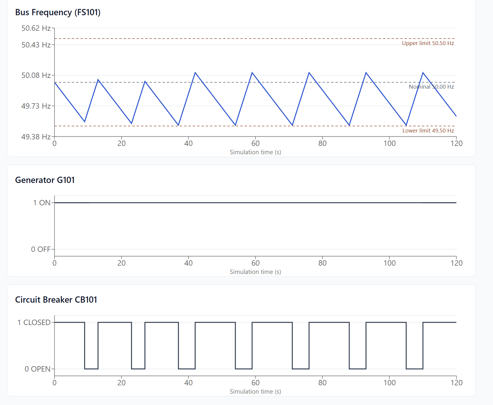
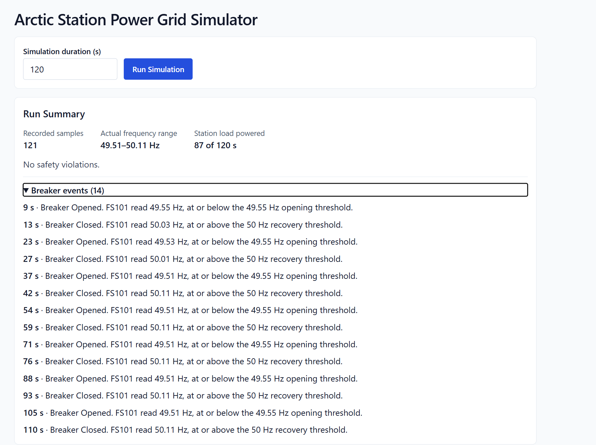
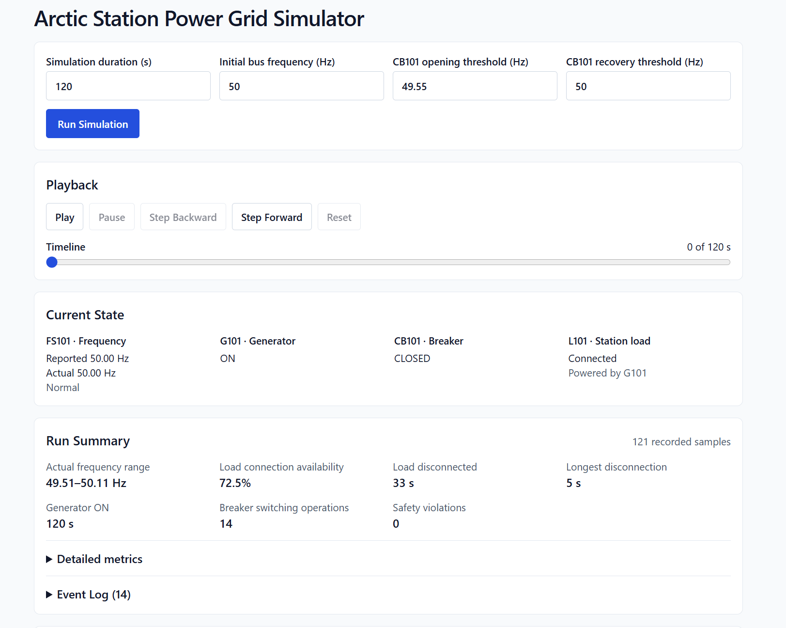

# Selected ChatGPT Requests

These are selected messages I wrote to ChatGPT while working through the power grid simulator. The project brief in the first exchange was extracted from the project brief word document. Screenshots were attached to some of the messages and are not reproduced here, please check the screenshots folder.

## 1. Initial implementation approach

> I need you to help me generate a prompt that I can feed Codex with to build a simulator that models a power system that a research team can train, test, and rehearse certain scenarios on. I need you to make sure that you prompt in a way that the simulator is firstly a basic working loop which i can then iterate on by feeding more prompts according to my objectives. Other things to ensure are:
>
> it must separate all sorts of simulation logic from rendering/ui  
> models must be configurable, where possible do not hard-code values  
> break the logic into small functions that can be reused where appropriate  
> to help with debugging, add sanity checks, help with logging state changes and please add comments sparingly for tricky parts of the code  
> clean and consistent code with the best design practices for software engineering, with sensible project structure and file management.  
> for the initial ui, insist on keeping it very simple, all we need first is a simple loop of the simulator to test if the logic is okay. i will tune the ui myself later on to make it intuitive
>
> finally, ensure that any new design assumptions are clearly mentioned
>
> Tech stack: python for the backend, use any react framework for the frontend just ensure there is tailwind css so i can edit css inline for any ui work.
>
> Below i am attaching the project brief, refer to it to come up with the prompt i can feed codex with.

**Context:** I supplied the original *Power Grid Simulator* task brief, including G101, CB101, L101, FS101, the nominal 50 Hz frequency, 49.50–50.50 Hz bounds, the four frequency rates, and the three required graphs.

## 2. Reviewing the first implementation

> The two screenshots i have attached show the results of the first iteration that codex has come up with.  
> Going through it myself, yes, i can say that it is an okay starting point and the logic seems to be checking out.  
> I have a few items you should be checking off:  
> Are we on the right track according to our functional requirements and assumptions?  
> "No safety violations" is reported. According to the requirements, it is reasonable, however is this of any help for the simulation? I think our next priority should be to come up with some sort of other helpful metrics that involves the generator and the other components.  
> In the 120s simulation run, the station load is powered for 87 seconds, the rest of the 33 seconds the station load is not being powered. Although the project brief did mention that the station load must be powered at all times, I believe this is a design limitation, is that so? If so, does the fixing of this issue exist in the scope of our project brief? If yes, just let me know how, do not prompt codex yet. If its not in the scope, just make it clear in the readme file later on.  
> Let me know what the next steps are for making a more interactive YET SIMPLE update to our iteration, and come up with the next prompt for codex. it is imperative that you remember all the rules i set in the previous message as well.

## 3. Reviewing the updated interface

> Take a look at the screenshots. Let me know how we can proceed next

## 4. Deciding whether to finish with UI work

> according to the project brief, is this a viable enough simulator? can we proceed to a final phase that is just a better ui (not too jam packed, just sleeker, and all the graphs and stuff fit in viewport so no need to scroll. the info should just be easy to digest but detailed as well)\
> take inspo from microsoft dashboards  
> (dont mention that in the prompt, but direct it in such a way)

## 5. Improving hierarchy and controls

> The UI currently is okay, but i think it is as though there is a lot to take in at a glance. I want the UI to be simple but to be comprehensive at the same time such that details are not lost.  
> I still want the graphs to be the biggest priority as per the functional requirements of the project brief. Most of all, the ui must be intuitive, and put all the elements of the simulator in the most sensible places possible. i.e, like the playback buttons.  
> make a better use of typography techniques, visual alignment, colors, visual feedback and indicators, hierarchy. Come up with the prompt to feed codex.

## 6. Completing the physical-state coverage

> okay prompt codex to account for this such that it is possible for us to simulate all the variation rates and stuff

## Additional verification discussions

Other questions in the same conversation concerned why frequency did not reach 50.50 Hz, why G101 was always ON during normal operation, interpretation of positive and negative FS101 bias, and analysis of the event log. These are summarized in `AI_USAGE.md` rather than reproduced as a full conversation transcript.
