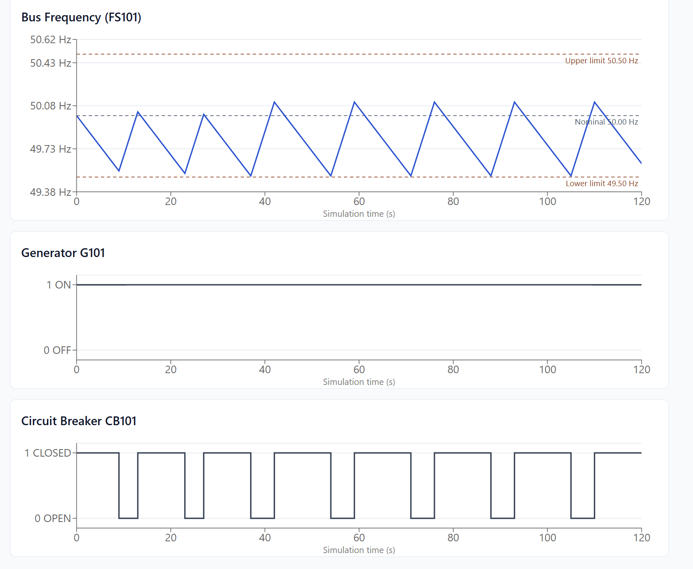
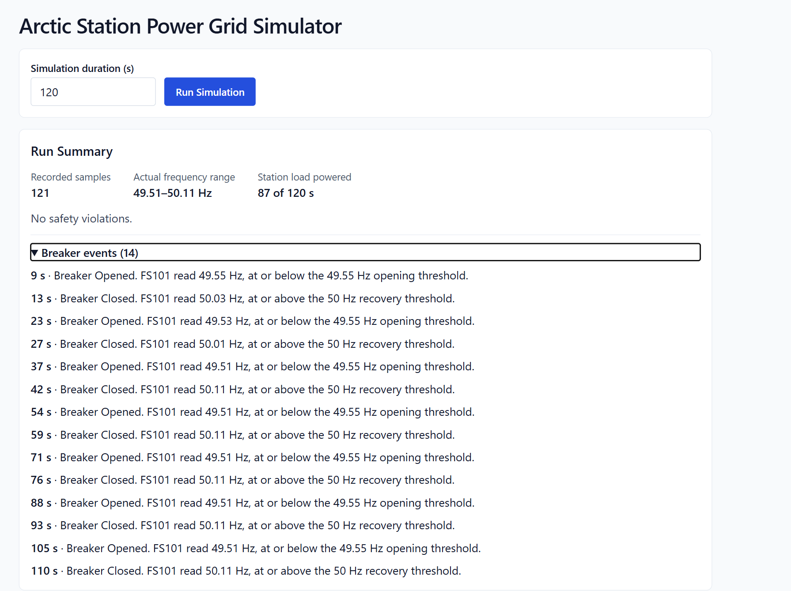
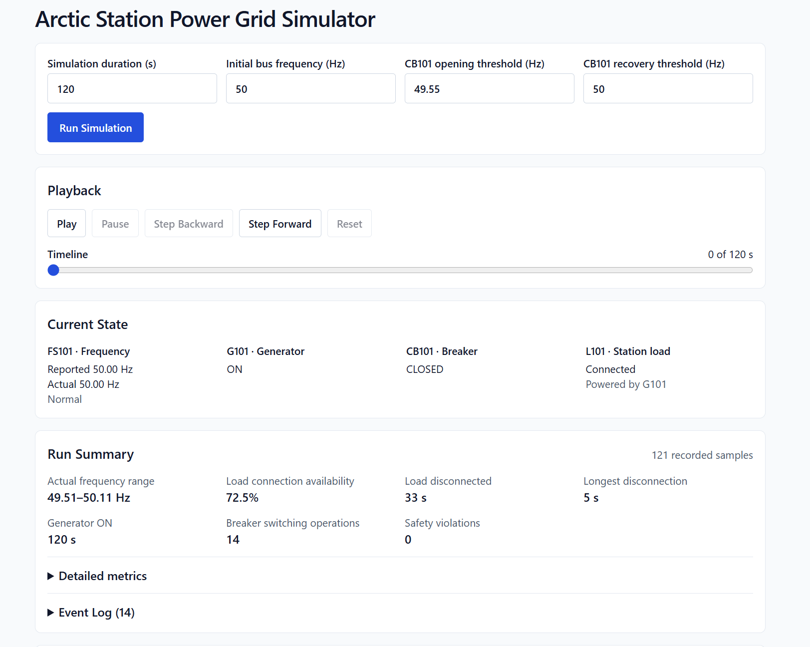
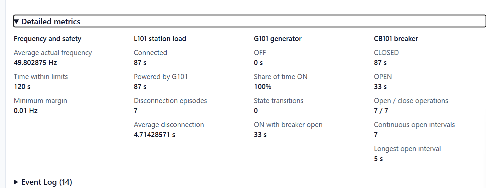
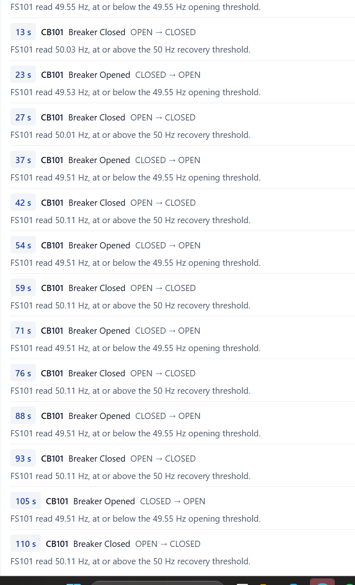
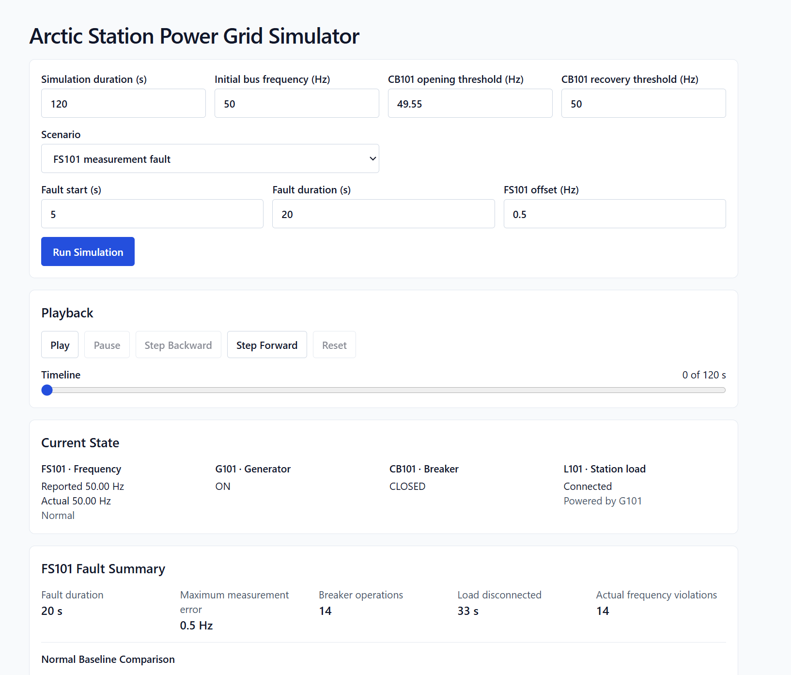
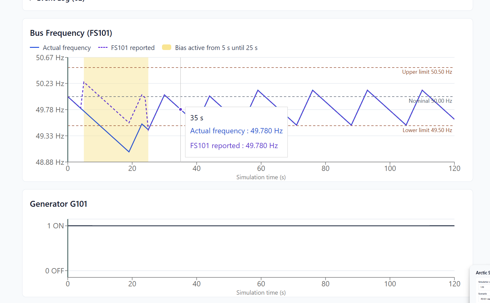

# AI Responses and Results — Condensed Record

This is a reading guide, **not a verbatim export of ChatGPT or Codex responses**. Include the exact large prompts sent to Codex in the separate prompt record. For each iteration, summarize the response and link to code, tests, or screenshots. If the assessor requests literal responses, export the full conversations separately and link them from here.

| Stage | What the AI proposed or produced | What I observed or checked | Evidence / follow-up |
| --- | --- | --- | --- |
| Initial build | A discrete-time Python engine, controller, and three graphs were proposed. | Normal run showed 87 seconds of powered load and 33 seconds disconnected in 120 seconds. I questioned whether zero safety violations represented effective operation. | TODO: link first iteration screenshot and commit. |
| Metrics and playback | More operational metrics and interactive review were proposed. | I reviewed whether the new metrics were useful rather than adding them all to the main dashboard. | TODO: link verified change. |
| FS101 faults | A configurable difference between reported and actual frequency was proposed. | I inspected both positive- and negative-bias runs; incorrect sensor measurements caused unsafe actual frequency or premature switching. | TODO: link relevant screenshots and tests. |
| Event logs | Separate routine decisions from operational transitions was proposed. | A 120-second run displayed 115 log events, including repeated unchanged-state decisions and duplicate breaker action descriptions. | TODO: link log and confirmed fix. |
| UI iteration | Layout and interaction refinements were proposed. | I requested separate graph cards, details modal, left controls/right graphs, clearer hover feedback, balanced sizing, and a more intuitive configuration panel. | See [UI follow-up prompts](ui-followups.md); TODO: add before/after evidence. |
| Generator states | Generator shutdown and manual state testing were proposed to demonstrate all four supplied rates. | TODO: record verification from actual tests, not just requested changes. | TODO: link test / commit. |

**How to complete:** Add one or two sentences about an actual Codex response (e.g. files implemented, explanation it gave, a test failure it reported), then record whether you accepted, rejected, or revised it. Don't invent quotes or claim an AI suggestion was implemented until confirmed.

### Iteration screenshots

**Phase 1 — Initial simulator**

**Phase 2 — Metrics and playback**

**Phase 3 — Sensor faults**

