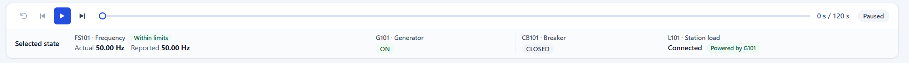
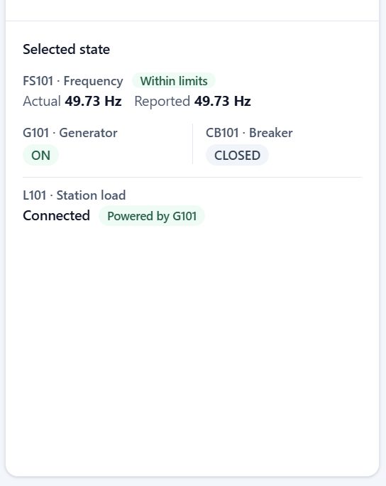

# Codex UI Follow-up Prompts

These are the exact prompts I used for some simple, but specific follow-ups to the UI, to ensure that it was sensible for the simulator according to the project requirements.

## UI-01 — Individual graph cards and run details

> Please separate the graphs into their own cards.
> whatever can be obscured into the run details option, do so
> also make the run details a modal popup not coming from the side
> where possible make use of more useful visual feedback like chips and pills

## UI-02 — Two-column layout and control feedback

> can you put these elements to the left of the screen and the rest of the graph stuff to the right? this might make it easier to balance out the visuals of the simulator.
> so all the details of the simulation run and simulation controls will be on the left, all the graphs will be on the right.
> feel free to use icons where applicable
> also, the playback buttons arent really buttons, when cursor hovers it should change into the hand state (visual feedback)

## UI-03 — Column sizing

> can you make the left column card reach the full heigh of the viewport like how the right column graph cards are reaching?

## UI-04 — Playback button styling

> and theres a weird colour switch for the play/pause button
> because it goes from solid blue to white
> make it a lighter shade of blue to solid blue on hover
> make the playback buttons' container take the full width of the card

## UI-05 — Spacing and configuration placement

> a lot of empty space down there
> distribute the existing content so that theres not so much empty space
> also when clicking configure (which is on the left) it is very unintuitive that the panel opens all the way on the right

## Outcomes (complete after verifying the implementation)

- **What changed:** TODO — note the final layout and interaction changes verified in the UI.
- **What still needed correction:** TODO — only include issues that you observed.
- **Evidence:** Link to one or two relevant before/after screenshots in `docs/ai-usage/screenshots/`.
